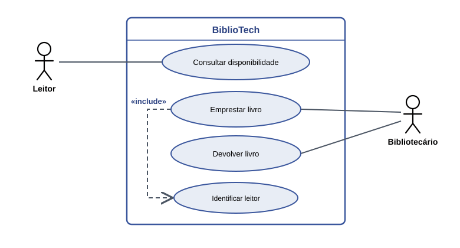
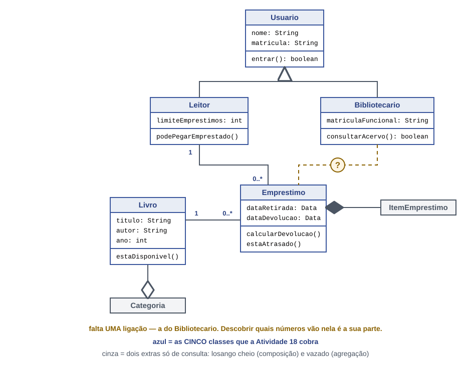

# BiblioTech
​
Sistema de emprestimo de livros para a biblioteca do campus.
​
## 1. O projeto
​
(O cliente do BiblioTech é a biblioteca do campus. O sistema serve para facilitar o empréstimo e a devolução de livros.
Ele ajuda a biblioteca a controlar quais livros estão disponíveis, quais estão emprestados e quem pegou cada livro. O sistema será usado pelos funcionários da biblioteca e pelos alunos do campus, deixando o processo mais rápido e organizado.)

## 3. Requisitos
​
### Requisitos funcionais
​
| # | Requisito funcional | Veio da |
|---|---|---|
| RF01 | O sistema deve permitir que a bibliotecaria cadastre um livro no acervo. | HU04 |
| RF02 | O sistema deve permitir que a bibliotecaria cadastre um leitor. | regra de acesso: so quem tem cadastro leva livro |
| RF03 | O sistema deve permitir que o leitor consulte a disponibilidade de um livro. | HU01 |
| RF04 | O sistema deve permitir que a bibliotecaria registre a devolucao de um livro. | HU02 |
| RF05 | O sistema deve permitir que a bibliotecaria registre o emprestimo de um livro. | HU03 |
| RF06 | (O sistema deve permitir que a bibliotecaria consulte os livros que estão emprestados.) |(necessidade da biblioteca) |
|RF06  | O sistema deve permitir que o leitor reserve um livro.	|HU06|
​
### Requisitos nao funcionais
​
| # | Requisito nao funcional |
|---|---|
| RNF01 | A consulta de disponibilidade deve responder em menos de 3 segundos. |
| RNF02 | Somente usuarios identificados como bibliotecarios podem alterar o acervo. |

## 4. Diagramas (feitos em APS)
​
### Casos de uso
​

​
### Classes
​


## 5. O que o codigo devolveu ao diagrama (Aula 37)

- Na classe `Livro`, foi adicionado o atributo `disponivel`, do tipo `boolean`, para saber se o livro está disponível ou emprestado.
- Na classe `Leitor`, foi adicionado o atributo `livrosEmMaos`, do tipo `int`, para contar quantos livros o leitor está com ele.


###
1. Em que linhas Emprestimo guarda referências a outros objetos?
Na classe Emprestimo, existem dois atributos que guardam referências:
private Livro livro;
private Leitor leitor;

No construtor, essas referências recebem os objetos:
this.livro = livro;
this.leitor = leitor;

Assim, o empréstimo sabe qual livro e qual leitor estão envolvidos.
2. Por que verificamos as condições antes de mudar o livro e o leitor?
O programa verifica primeiro se o empréstimo pode acontecer, se o livro está disponível e se o leitor pode pegar outro livro.
Só depois ele altera os objetos:
livro.emprestar();
leitor.pegouLivro();

Isso evita alterações quando o empréstimo não pode ser realizado.
3. O que impede uma segunda devolução de reduzir o contador novamente?
O programa verifica se o empréstimo está ativo:
if (!ativo) {
    return false;
}

Depois da primeira devolução, o empréstimo fica inativo:
leitor.devolveuLivro();
ativo = false;

Assim, uma segunda devolução é bloqueada e o contador não diminui novamente.
Conclusão
A classe Emprestimo controla a relação entre livro e leitor, evitando empréstimos inválidos e devoluções duplicadas. Isso mantém as informações do sistema corretas.
###


## 6. Como executar

No Codespace, dentro da pasta `bibliotech`:

```bash
javac *.java
java TesteRequisitos
java TelaBiblioteca
```

`TesteRequisitos` verifica os requisitos no terminal.
`TelaBiblioteca` abre a janela do BiblioTech.

## 7. Requisitos e verificações

| Requisito | Onde está no código | Como verifico |
|---|---|---|
| RF01 | `Biblioteca.cadastrarLivro()` | TesteRequisitos |
| RF02 | `Biblioteca.cadastrarLeitor()` | TesteRequisitos |
| RF03 | `Biblioteca.buscarLivro()` e `Livro.estaDisponivel()` | TesteRequisitos e acervo |
| RF04 | `Biblioteca.devolver()` e `Emprestimo.registrarDevolucao()` | TesteRequisitos e botão Devolver |
| RF05 | `Biblioteca.emprestar()` e `Emprestimo.realizarEmprestimo()` | TesteRequisitos e botão Emprestar |
| RF06 | [Descrever o que você implementou ou indicar que ainda não foi implementado] | [Descrever a verificação ou indicar que ainda não existe] |

## 8. O que o BiblioTech ainda não faz

- Os empréstimos ainda não têm prazo para identificar atrasos.
- A janela não tem login de bibliotecário.
- O cadastro de livros e leitores pela janela ainda é limitado.
- Os dados dos empréstimos não são mantidos depois que o programa é fechado.

1\. Qual é a diferença entre o servidor MariaDB e o banco de dados `bibliotech`?

O MariaDB é o sistema que gerencia os bancos de dados. Já o `bibliotech` é um banco de dados específico, criado para guardar as informações do sistema da biblioteca, como livros, leitores e empréstimos.

2\. Para que serve o comando `CREATE DATABASE`?

O comando `CREATE DATABASE` serve para criar um novo banco de dados no MariaDB. No nosso projeto, usamos esse comando para criar o banco de dados `bibliotech`.

3\. Por que criamos um usuário específico para o BiblioTech?

Criamos um usuário específico para o BiblioTech para aumentar a segurança do sistema. Assim, ele terá apenas as permissões necessárias para acessar e modificar os dados, sem precisar usar o administrador do MariaDB.

## Conexão com o Banco de Dados

### Banco de dados utilizado

O projeto utiliza o **MariaDB**, com o banco de dados chamado `bibliotech`, para armazenar as informações dos livros, como título, autor e ano de publicação.

### Classe `Conexao`

A classe `Conexao` é responsável por realizar a conexão entre a aplicação Java e o banco de dados MariaDB. Ela utiliza as variáveis de ambiente `DB_USER` e `DB_PASSWORD` para obter o usuário e a senha do banco de dados, evitando deixar essas informações diretamente no código-fonte.

### Classe `LivroDAO`

A classe `LivroDAO` é responsável por executar as operações de cadastro, atualização e exclusão de livros no banco de dados. Para realizar essas operações, utiliza comandos SQL com `PreparedStatement`, permitindo enviar os valores de forma segura.

### Métodos implementados

- **`adicionarLivro()`**: cadastra um novo livro com título, autor e ano de publicação.
- **`atualizarLivro()`**: modifica os dados de um livro já cadastrado, utilizando seu identificador (`id`).
- **`excluirLivro()`**: remove um livro do banco de dados a partir de seu identificador (`id`).

Os métodos retornam `true` quando a operação é realizada com sucesso e `false` quando não há alteração ou ocorre uma falha.

### Como executar os testes

**1. Teste de conexão**

O arquivo `TesteConexao.java` verifica se a aplicação consegue se conectar ao MariaDB.

No terminal, execute:

```bash
javac -cp ".;lib/*" Conexao.java TesteConexao.java
java -cp ".;lib/*" TesteConexao
```

No Linux ou Codespaces, substitua `;` por `:` no caminho de classe.

Se aparecer a mensagem `Conexão realizada com sucesso!`, a conexão foi estabelecida.

**2. Testes de persistência**

O arquivo `TesteLivroDAO.java` permite testar as operações de cadastro, atualização e exclusão de livros.

No Windows, execute:

```bash
javac -cp ".;lib/*" Conexao.java LivroDAO.java TesteLivroDAO.java
java -cp ".;lib/*" TesteLivroDAO
```

No Linux ou Codespaces, utilize `".:lib/*"` no lugar de `".;lib/*"`.

**3. Conferência dos dados**

Para verificar os registros diretamente no MariaDB, execute:

```sql
USE bibliotech;
SELECT * FROM livros;
```

Após cadastrar, atualizar ou excluir livros pelo Java, consulte a tabela novamente para confirmar as alterações. Também é possível encerrar o programa Java e repetir a consulta para verificar se os registros continuam armazenados.

### Variáveis de ambiente

A aplicação utiliza as seguintes variáveis de ambiente:

- `DB_USER`: usuário utilizado para acessar o banco de dados.
- `DB_PASSWORD`: senha do usuário do banco de dados.

Essas variáveis devem estar configuradas no ambiente em que a aplicação será executada. Não é recomendado publicar senhas ou outras informações de acesso no repositório GitHub.